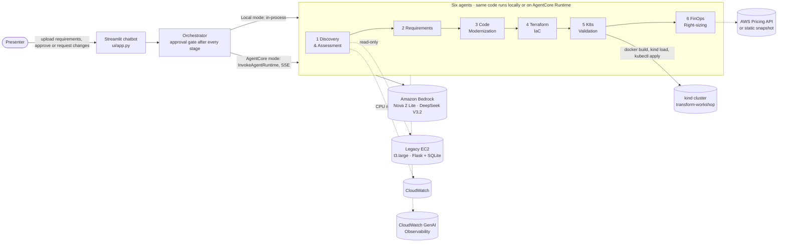

# Running the workshop: AWS Transform × Amazon Bedrock AgentCore

This guide covers everything needed to set up, deploy, rehearse, present and tear down the 1-hour workshop.
It uses six AgentCore agents to rebuild, step by step, what AWS Transform's agents do under the hood. They take a legacy Flask
monolith running on one EC2 instance and turn it into a containerized microservice on Kubernetes, with a chatbot UI
and a human approval gate after every step.

> **Reading order:** sections 1–3 once, section 4 (deploy) about a week before the talk, section 5 (rehearse) the
> day before, then sections 6–7 on the day. Section 8 is the plan B, for when anything breaks on stage.

---

## 1. What the audience sees



| # | Agent | What it does at a low level | AWS Transform analogue | Model |
|---|---|---|---|---|
| 1 | Discovery & Assessment | Static code scan (routes, SQLi, secrets, local state), parses the legacy Terraform, reads live EC2 and CloudWatch, then picks a 6R strategy and readiness score | Discovery & assessment | Nova 2 Lite |
| 2 | Requirements | Turns the uploaded requirements file into a validated migration spec with a traceability matrix and open questions | Job objective intake, human-in-the-loop clarifications | Nova 2 Lite |
| 3 | Code Modernization | Renders a tested 12-factor microservice pattern, ports the legacy API into it, fixes the findings and runs the generated tests | Transform custom / code transformation, containerization | DeepSeek V3.2 |
| 4 | Terraform | Adapts a validated VPC + EKS + ECR + RDS blueprint to the spec, then runs `terraform validate` and spec checks | Network and infrastructure conversion to IaC | Nova 2 Lite |
| 5 | K8s Validation | kubeconform plus a 16-rule policy baseline; fixes violations and deploys live to kind with smoke tests | Test & validation | Nova 2 Lite |
| 6 | FinOps | Prices current vs as-designed vs optimized from deterministic tools, right-sizes pods and nodes, and checks the budget | Assessment TCO / business case | Nova 2 Lite |

Models are set in [transform_agents/core/config.py](transform_agents/core/config.py). Override them per agent with `MODEL_<AGENT>=...`
(e.g. `MODEL_TERRAFORM=mistral.mistral-large-3-675b-instruct`). The benchmark behind these choices is in
[docs/PLAN.md](docs/PLAN.md). Stage inputs and outputs are in [docs/CONTRACTS.md](docs/CONTRACTS.md).

**Key messages for the talk**
- **Agents ground themselves in curated blueprints and deterministic validators.** In our benchmark, no model could
  write EKS Terraform from scratch that validated (their training predates the v21 module), but every one of them
  succeeded when it adapted a validated blueprint. AWS Transform works the same way: curated transformation definitions
  with validation in the loop.
- **LLMs decide and explain; Python tools do the counting.** All FinOps numbers come from tested code.
- **The human stays in the loop.** Every stage stops at a gate: approve, or request changes in plain language.
- **The same code runs locally and on AgentCore Runtime.** AgentCore is framework- and model-agnostic (Strands + Nova/DeepSeek here).
- **Planted "aha" moment.** The spec and Terraform ask for Kubernetes **1.33**, which went into EKS *extended support* on
  2026-07-29. The FinOps agent catches it: about **+$365/month**, and the as-designed cost goes over budget. The optimized
  plan upgrades to 1.36 and fits the $450 budget.

---

## 2. Prerequisites

| Need | Check | Notes |
|---|---|---|
| macOS or Linux, 8 GB+ RAM free for Docker | | Tested on Apple Silicon |
| `uv`, Node ≥ 20 / npm, AWS CLI v2, Terraform ≥ 1.6, kubectl, Docker Desktop | `uv --version`, `node -v`, `aws --version`, `terraform -version`, `kubectl version --client`, `docker info` | kind and kubeconform are installed repo-locally by `make tools` |
| AWS account with admin rights (SSO profile) | `aws sts get-caller-identity` | Region **us-west-2** |
| Bedrock model access: Nova 2 Lite (`us.amazon.nova-2-lite-v1:0`), DeepSeek V3.2 (`deepseek.v3.2`) | `make preflight` | Optional: Mistral Large 3. Enable models in the Bedrock console → Model catalog if a call returns AccessDenied |

Every command below assumes you start a new terminal like this:

```bash
cd transform-agentcore-workshop
export AWS_PROFILE=personal-dev AWS_REGION=us-west-2   # your SSO profile
aws sso login --profile "$AWS_PROFILE"                 # SSO sessions expire after several hours
```

---

## 3. One-time local setup (about 10 minutes)

```bash
make install        # uv sync --all-extras (Python 3.12 venv with Strands, AgentCore SDK, Streamlit)
make tools          # kind + kubeconform into ./.tools/bin (sha256-verified, no sudo)
make kind-up        # local cluster "transform-workshop" (~40 s cold, ~1 s if it already exists)
make test           # ~260 unit tests, no AWS calls
make preflight      # credentials, Bedrock access per model, Docker, kind, Terraform warm-up, test-env warm-up
```

`make preflight` also warms the Terraform provider and module cache and the generated-service test environment.
That keeps the Terraform and Modernization stages fast on stage. Run it again on the day.

---

## 4. Deploy to AWS (you run these, ideally a week before the talk)

Nothing in AWS is created until you run these commands. Every step can be undone (section 9).

### 4.1 The legacy estate on EC2 (~3 minutes, about $2.24/day)

```bash
scripts/legacy-up.sh                      # plan, asks for confirmation, applies, waits until the app answers
# or lock port 80 to your IP:
ALLOWED_CIDR="$(curl -s https://checkip.amazonaws.com)/32" scripts/legacy-up.sh
terraform -chdir=legacy-infra/terraform output    # app_url, instance_id, ssm_session_command, smoke_test
scripts/legacy-load.sh "" 15              # 15 minutes of mixed traffic, so CloudWatch and the order table have data
```

It creates one t3.large (deliberately oversized), a gp2 30 GiB volume, a security group allowing port 80, and an IAM role for SSM.
There is no SSH: use `aws ssm start-session --target <instance_id>`. Deploy it **at least a day before** the talk so
the Discovery agent's **Live AWS discovery** toggle finds real CloudWatch CPU data.
The deliberate legacy smells, with file and line for each, are listed in [legacy-infra/README.md](legacy-infra/README.md#deliberate-legacy-smells).

### 4.2 The agents on Amazon Bedrock AgentCore Runtime (~10–15 minutes the first time)

Use a good network: the first deploy uploads about 450 MB.

```bash
DRY_RUN=1 deploy/deploy.sh                # optional: packages and synthesizes all agents, creates nothing
deploy/deploy.sh                          # or: make deploy-agents
```

On the first run it creates:
- the one-time **CDKToolkit** bootstrap stack (S3 asset bucket, ECR, deploy roles);
- one AgentCore Runtime per agent (`hello` plus the six stages) with IAM execution roles. They're billed only while invoked.

It writes `deploy/agent-arns.json`, which the UI's **AgentCore Runtime** mode reads.

Verify:

```bash
deploy/status.sh                                          # every runtime READY
deploy/invoke.sh hello 'List the files and report.'       # pretty-printed SSE events from the cloud
deploy/invoke.sh finops '{"prompt":"Estimate the migration cost"}'
deploy/logs.sh finops                                     # CloudWatch logs (last 30 min)
deploy/logs.sh finops traces                              # AgentCore traces
make run-cli MODE=agentcore                               # full pipeline in the cloud, headless
```

Traces are in the console under **CloudWatch → GenAI Observability → Bedrock AgentCore** (Transaction Search is
already on in this account). Details are in [deploy/README.md](deploy/README.md).

Differences in the cloud:
- The K8s Validation agent can't reach your laptop's kind cluster, so the **live deploy** step runs only in Local mode.
- The Terraform agent validates offline (HCL parse plus module-argument checks) because there's no provider cache.
- Everything else behaves the same.

### 4.3 EKS itself: not deployed

The Terraform agent *generates* the EKS, VPC, ECR and RDS code and validates it. It is **not** applied, because that would cost about
$210–$620/month. The live Kubernetes demo runs on kind. If you want to show a real `terraform plan`, run it read-only on the
generated code in `runs/<id>/workspace/terraform`.

---

## 5. Rehearse and record a fallback (the day before)

```bash
make ui                                   # http://localhost:8501
```

In the sidebar choose **Local (in-process)**, turn on **Live AWS discovery**, **Live deploy to kind** and
**🧪 Simulate manual drift**, then run the whole flow once (section 7). Or run it headless:

```bash
uv run python -m transform_agents.orchestrator --requirements samples/requirements/migration-requirements.md \
    --mode local --auto-approve --live-aws --live-deploy --simulate-drift      # ~2 minutes
make record RUN=runs/<id>                 # copy that complete run into samples/recorded-run/ (the stage fallback)
make replay                               # check the recording replays (REPLAY_FROM=recorded)
```

Every run is saved under `runs/<run_id>/`: `state.json`, plus per stage `result.json`, `events.jsonl` and the merged
`workspace/` with all generated files, which you can open in the IDE during the talk. `make clean` keeps `runs/` unless you pass `CLEAN_RUNS=1`.

Reference timings from a real local run (2026-10-20):

| Stage | Time | Highlights |
|---|---|---|
| Discovery | ~8 s | 17 findings (SQLi critical), readiness ~40/100, replatform |
| Requirements | ~17 s | 24 requirements traced, budget $450, 3 open questions |
| Modernization | ~45–75 s | 32 files, generated tests pass, non-root image |
| Terraform | ~15 s | `terraform validate` passes, Graviton t4g.medium, RDS Multi-AZ |
| K8s Validation | ~15 s | with drift on: 4 injected violations detected and fixed, live kind deploy, smoke tests 200/200/200/201/409 |
| FinOps | ~9 s | $72 today → $623 as designed (1.33 extended support) → $208 optimized (within $450) |

---

## 6. Day-of checklist

**T-60 min**
- [ ] `aws sso login --profile personal-dev`
- [ ] Docker Desktop running, then `make kind-up`
- [ ] `make preflight`: all green
- [ ] `deploy/status.sh`: all runtimes READY (if you show AgentCore mode)
- [ ] Legacy app answers: `curl -s "$(terraform -chdir=legacy-infra/terraform output -raw app_url)/api/items" | head`
- [ ] `samples/recorded-run/` exists (fallback) and `make replay` works

**T-15 min**
- [ ] `make ui`, then open http://localhost:8501 in a large-font browser window (Cmd + to ~125%)
- [ ] Sidebar: mode **Local**, toggles **Live AWS discovery ON**, **Live deploy to kind ON**, **Simulate manual drift ON**, **Live pricing OFF**
- [ ] Click **New run**
- [ ] Other tabs ready: the legacy app URL, CloudWatch GenAI Observability, the AWS Transform product page
- [ ] A terminal with a large font, in the repo, with `AWS_PROFILE` exported
- [ ] Notifications off, laptop on power, screen sleep disabled

---

## 7. Run of show: 60 minutes

Each module shows what to click, what the audience sees, and the talking points. The checkpoint tells you whether you're on track.

### 00–05 · Intro: AWS Transform under the hood
- AWS Transform runs agentic migration jobs: discovery → assessment → planning → code and IaC transformation → validation,
  with humans approving each job step.
- Today we rebuild that loop with **six agents on Amazon Bedrock AgentCore**: Runtime to host them, Observability for traces,
  with Strands as the agent framework and Bedrock models (Nova, DeepSeek). Show the diagram from section 1.

### 05–10 · Module 1: the legacy estate
- Open the legacy app URL: the 2017 inventory dashboard.
- Terminal: show the SQL injection.
  ```bash
  URL=$(terraform -chdir=legacy-infra/terraform output -raw app_url)
  curl -s "$URL/api/items?search=%25'%20OR%20'1'='1" | head -c 300
  ```
- Show [legacy-infra/app/app.py](legacy-infra/app/app.py): hard-coded secrets, dev server as root, SQLite and reports on local disk.
- In the console: a t3.large at about 4% CPU on gp2. "This is the estate we will hand to the agents."
- **Checkpoint:** 10:00.

### 10–15 · Module 2: Discovery & Assessment agent
- UI: **Start migration**. Watch the tool timeline: `scan_codebase` → `parse_legacy_terraform` → `describe_live_instance`
  / `get_utilization` (live) → `submit_result`.
- Result card: findings table (LF-01 SQLi **critical**), readiness score, CPU avg/p95, strategy **replatform**.
- Talking point: the deterministic tools find the evidence; the model only weighs severity and strategy. That's why it takes about 8 seconds.
- **Approve & continue.** **Checkpoint:** 15:00.

### 15–21 · Module 3: Requirements agent (upload the file)
- Upload [samples/requirements/migration-requirements.md](samples/requirements/migration-requirements.md) (drag and drop, or
  click **Use sample requirements**). Briefly show the file: $450 budget, 99.9% SLO, 40 rps, Graviton, RDS.
- Watch `set_fields` / `set_lists` / `check_spec`: the agent fills a typed spec and a validator checks it.
- Result: requirements table traced to findings (SEC5 → LF-01), plus the **open questions** with assumptions (3× growth, dev/test, cutover).
- **Show human-in-the-loop:** click **Request changes** and type
  *"Assume dev/test is out of scope for now and size for today's traffic; keep replicas_max for the 3x growth."*
  The agent revises only what you asked.
- **Approve.** **Checkpoint:** 21:00.

### 21–30 · Module 4: Code Modernization agent (the longest stage, 45–75 s)
- While it runs, explain the approach: deterministic tools render a **tested platform pattern** (config from env,
  `/healthz` and `/readyz`, JSON logs, gunicorn, a non-root read-only Dockerfile, a Kustomize base and a kind overlay). DeepSeek only ports
  the legacy routes into `app/api.py` and writes tests. Then it loops on `run_service_tests` and `validate_manifests`.
- Result: changes table (SQLi fixed by parameterized queries, secrets from env, oversell is now transactional), file tree,
  and the tests passing.
- Open `runs/<id>/workspace/microservice/app/api.py` next to the legacy `app.py` in the IDE.
- **Approve.** **Checkpoint:** 30:00.

### 30–37 · Module 5: Terraform agent
- Tool timeline: `get_blueprint` → `set_variables` (one call maps the spec: region, Graviton t4g, node min/max from
  replicas, RDS PostgreSQL Multi-AZ, ECR repository named after the image) → `terraform_validate` (fmt, HCL, module
  arguments, real `terraform validate`, spec checks).
- Story: "We first let the models write this from scratch. All of them failed: they used the old EKS module arguments. Grounded in a
  validated blueprint, they pass first time." Note that it uses Kubernetes **1.33** (from the spec). Don't comment on it yet.
- **Approve.** **Checkpoint:** 37:00.

### 37–45 · Module 6: K8s Validation agent + live deploy
- With **Simulate manual drift** on, the agent first injects typical hand edits, all clearly labelled as simulated: an image `:latest`, missing
  limits, a writable root filesystem, and the PDB dropped from kustomization.
- Watch: kubeconform → policy check (violations) → `edit_file` fixes → re-check → `deploy_to_kind` → smoke tests.
- Result: before/after policy table, plus live deploy smoke tests (GET 200s, POST order 201, oversell **409**).
- Terminal:
  ```bash
  kubectl --context kind-transform-workshop -n inventory get pods,svc,hpa,pdb
  kubectl --context kind-transform-workshop -n inventory port-forward svc/inventory-service 8080:80 &
  curl -s localhost:8080/api/items | head -c 300; curl -s "localhost:8080/api/items?search=%25'%20OR%20'1'='1"
  ```
  The SQL injection no longer returns everything.
- **Approve.** **Checkpoint:** 45:00.

### 45–51 · Module 7: FinOps agent (the aha moment)
- Chart: **current ~$72 → as designed ~$623 (over the $450 budget) → optimized ~$208 (within budget)**.
- The reveal: Kubernetes 1.33 is in **EKS extended support**, costing **+$365/month**. "The FinOps agent caught what the IaC agent
  and the spec missed." Recommendation FO-01: upgrade to 1.36.
- Be honest with the audience: the target still costs about 3× today's single box. What that buys: the 99.9% SLO, Multi-AZ,
  backups, autoscaling and the security fixes. Every number comes from tested Python, priced from a dated AWS Pricing API snapshot.
- **Approve**, and the wrap-up message appears. Optionally **Download all artifacts (zip)**. **Checkpoint:** 51:00.

### 51–57 · Module 8: the same agents on AgentCore Runtime
- Sidebar → mode **AgentCore Runtime** (the stepper shows the deployed runtimes). Start a **New run** and run
  Discovery (8 s), the same code now running in AgentCore. Or re-run FinOps with **Request changes**: *"Show the cost without any commitments."*
- Terminal, the AgentCore CLI view:
  ```bash
  deploy/status.sh
  deploy/invoke.sh finops '{"prompt":"Estimate the migration cost"}'
  deploy/logs.sh finops traces
  ```
- Console: **CloudWatch → GenAI Observability → Bedrock AgentCore**: sessions, spans per tool call, token counts and latency.
- **Checkpoint:** 57:00.

### 57–60 · Wrap-up
- What was real: Bedrock models, AgentCore Runtime, live AWS reads, a real kind deploy, real `terraform validate`.
  What was simplified: EKS not applied; one service extracted rather than a full decomposition; curated blueprints in place of AWS
  Transform's managed transformation library.
- Close with the repository link and Q&A.

---

## 8. Plan B: when something breaks on stage

| Symptom | Do this |
|---|---|
| Wi-Fi or Bedrock down, or throttling (`ThrottlingException`) | Sidebar → **Replay (offline)**. The recorded run plays with the same UI and timings. Or from the terminal: `make replay`. |
| A stage fails mid-demo | The gate offers **Retry**. On a failed *revision*, use **Approve previous result** to keep the last good output. |
| A stage is slow (more than 90 s) | Keep talking. Every agent has a hard deadline and returns a deterministic fallback result. If it's still stuck, switch to Replay. |
| `ExpiredToken` / SSO errors | `aws sso login --profile personal-dev`, then **Retry**. |
| Terraform stage stuck on `terraform init` | Stop the UI and start it again with `TERRAFORM_OFFLINE=1 make ui` (offline validation only). |
| kind deploy fails | `docker info`, then `make kind-up`, then **Retry**. Diagnose with `kubectl --context kind-transform-workshop -n inventory describe pods`. |
| AgentCore mode says "no AgentCore Runtime ARN" | `deploy/agent-arns.json` is missing: run `deploy/deploy.sh` (before the talk). On stage, switch back to **Local**. |
| Port 8501 busy | `UI_PORT=8502 make ui` |
| Legacy URL not answering | Use the Terraform-based discovery (turn off **Live AWS discovery**). The demo works without the EC2. |

Model fallback for any stage: `MODEL_<STAGE>=<model-id> make ui`. Tested alternatives:
- Terraform: `mistral.mistral-large-3-675b-instruct`, `deepseek.v3.2`
- Modernization: `us.amazon.nova-2-lite-v1:0` (faster), `mistral.mistral-large-3-675b-instruct`
- K8s Validation: `mistral.ministral-3-14b-instruct` (fastest)

---

## 9. Teardown and costs

```bash
scripts/legacy-down.sh        # destroys the EC2 estate (type "yes")
deploy/destroy.sh             # removes all AgentCore runtimes and roles (or: make destroy-agents)
make kind-down                # deletes the local cluster
```

`destroy.sh` keeps the one-time `CDKToolkit` stack. To remove it too, empty the bucket
`cdk-hnb659fds-assets-<account>-us-west-2`, then run `aws cloudformation delete-stack --stack-name CDKToolkit`.

| Item | Cost |
|---|---|
| Legacy EC2 (t3.large + gp2 30 GiB) | ~$2.24/day while deployed |
| AgentCore Runtime (7 runtimes) | $0 idle; well under $0.10 of runtime per full pipeline run |
| Bedrock tokens | ~200k tokens per full run, a few cents |
| kind, Streamlit, local runs | free |
| EKS / RDS from the generated Terraform | not deployed ($210–$620/month if applied) |

---

## 10. Reference

| Path | What it is |
|---|---|
| [legacy-infra/](legacy-infra/) | The current estate: Flask monolith (`app/`), EC2 Terraform (`terraform/`), smells table |
| [samples/requirements/](samples/requirements/) | The requirements file uploaded on stage |
| [transform_agents/core/](transform_agents/core/) | Shared contract, Strands runner, workspace tools, model config, AgentCore app wrapper |
| `transform_agents/<stage>/` | One agent per stage: `agent.py` (prompt + loop), `tools.py` (deterministic tools), `knowledge/` (blueprints), `runtime.py` (AgentCore entrypoint) |
| [transform_agents/orchestrator/](transform_agents/orchestrator/) | Pipeline, approval gates, run persistence, Local / AgentCore / Replay clients, headless CLI |
| [ui/](ui/) | Streamlit chatbot |
| [deploy/](deploy/) | AgentCore CLI project and scripts (deploy, invoke, status, logs, destroy) |
| [scripts/](scripts/) | kind, tools, legacy estate, preflight |
| [docs/PLAN.md](docs/PLAN.md), [docs/CONTRACTS.md](docs/CONTRACTS.md) | Design decisions, model benchmark, stage contracts |

Useful environment variables:

| Variable | Effect |
|---|---|
| `AWS_PROFILE`, `AWS_REGION` | Credentials and region (us-west-2) |
| `MODEL_ID`, `MODEL_<STAGE>` | Model for all agents or one agent |
| `MODEL_READ_TIMEOUT` | Bedrock stream read timeout in seconds (default 120) |
| `TERRAFORM_OFFLINE=1` | Terraform agent skips `terraform init/validate` |
| `UI_PORT` | Streamlit port (default 8501) |
| `REPLAY_FROM` | `recorded` (default), `latest`, or `runs/<id>` |
