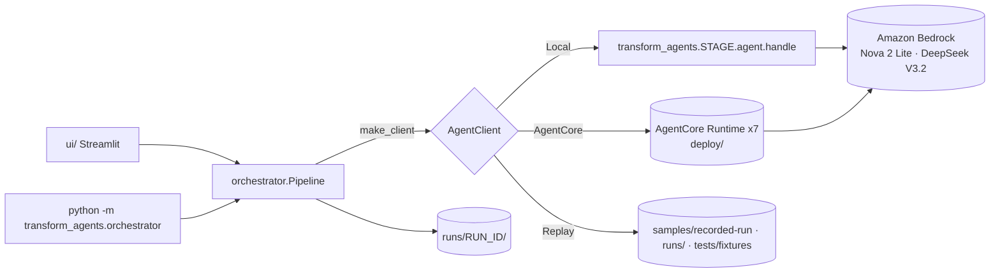

# Architecture spec

> Last verified: 2026-10-20 · Scope: the system as a whole: core contract, orchestrator, clients, run persistence,
> deployment topology. Agent internals are in [02-agents.md](02-agents.md); the UI is in [03-ui.md](03-ui.md).

## 1. Purpose and scope

The workshop rebuilds, in the open, the loop AWS Transform's migration agents run. Six Strands agents on Amazon Bedrock
take a legacy Flask monolith on EC2 to a containerized microservice on Kubernetes. A Streamlit chatbot puts a human
approval gate after every agent. The same agent code runs **in-process** (Local mode) and on **Amazon Bedrock AgentCore
Runtime** (AgentCore mode). A recorded run can be **replayed** offline as the plan B on stage.

## 2. Invariants

1. **Same code, two runtimes.** Every stage agent MUST be usable in-process (`handle(request)`) and behind
   `BedrockAgentCoreApp` (`runtime.py` → `core/app.py:make_app`) with identical events.
2. **One contract.** Requests MUST be `AgentRequest` ([core/contract.py](../../transform_agents/core/contract.py)).
   Streams MUST emit only the contract event types and end with **exactly one** `result` or `error`.
3. **Artifacts travel in the payload.** Agents MUST NOT rely on a shared filesystem between stages. Inputs arrive as
   `files` and `inputs`; outputs leave as `result.artifacts`. (Documented exceptions, local defaults only: requirements
   and modernization fall back to the repo's sample files, discovery to `legacy-infra/`, and k8s_validation looks for
   binaries in `.tools/bin` before `PATH`.)
4. **[docs/CONTRACTS.md](../CONTRACTS.md) is normative.** `result.data` MUST keep its required fields. Adding fields is
   fine; renaming or removing them is a breaking change that needs every consumer updated in the same change.
5. **The orchestrator is deterministic.** Stage order, inputs and gates are code (`STAGE_INPUTS`), not model decisions.
   A stage MUST NOT start until the previous stage is approved.
6. **The human is the gate.** Every stage ends in `awaiting_approval`. Revisions carry the feedback plus the previous
   artifacts and the previous data (`inputs.previous`). A failed revision MUST leave the previous good result approvable.
7. **Runs are durable and replayable.** Every event of every attempt MUST be persisted (`events.jsonl` plus `history/`)
   so the run can be resumed, inspected and replayed.
8. **Agents never create AWS resources.** Only read-only AWS calls, plus Bedrock invocations, are allowed at runtime.
9. **Model families.** Only Amazon Nova, Mistral, DeepSeek, Meta Llama 3.x and Amazon Titan through the Bedrock Converse
   API (a user decision; see [02-agents.md](02-agents.md)).

## 3. Components



| Component | Path | Responsibility |
|---|---|---|
| Core | [transform_agents/core/](../../transform_agents/core/) | Contract, `Workspace` + workspace tools, `run_agent` (Strands loop → events), `make_app`, model config |
| Stage agents | `transform_agents/<stage>/` | One package per stage: `agent.py`, `tools.py`, `knowledge/`, `runtime.py` |
| Orchestrator | [transform_agents/orchestrator/](../../transform_agents/orchestrator/) | `Pipeline` (gates, persistence, request building), clients, `record`, headless CLI |
| UI | [ui/](../../ui/) | Chatbot over `Pipeline`; see [03-ui.md](03-ui.md) |
| Deploy | [deploy/](../../deploy/) | AgentCore CLI project packaging every stage as its own runtime; see [04-operations.md](04-operations.md) |
| Legacy estate | [legacy-infra/](../../legacy-infra/) | The "before" system (Flask on EC2, Terraform) |

## 4. The contract

- **Request** (`AgentRequest.from_payload`): `run_id`, `instruction` (or `prompt`, which is what `agentcore invoke`
  sends), `feedback`, `inputs`, `files` (path → text), `options`. Payloads that aren't objects are rejected with an
  `error` event.
- **Events:** `status`, `text` (deltas, scrubbed of leaked model markers), `tool_start`, `tool_end`, `artifact`, then a
  final `result` (`stage, summary, data, artifacts, metrics`) or `error`. On AgentCore each event is one SSE `data:` line.
- **Metrics** include `model`, `latency_s`, `input_tokens`, `output_tokens`, `cycles`, `stop_reason` and `submitted`.
  Agents may add more (e.g. `fallback`, `validation_level`).
- **Options:** see the options reference in [CONTRACTS.md](../CONTRACTS.md). An option MUST be documented there before
  the orchestrator or the UI sends it.

## 5. Stage data flow

`STAGE_INPUTS` in [pipeline.py](../../transform_agents/orchestrator/pipeline.py) decides which earlier results feed each stage:

| Stage | `inputs` from | `files` sent |
|---|---|---|
| discovery | none | the legacy estate, `legacy/app/**` and `legacy/terraform/**` (`load_legacy_estate`) |
| requirements | assessment ← discovery | `requirements/<uploaded file>` |
| modernization | assessment, spec | `legacy/app/**` |
| terraform | spec, assessment, modernization | none (the blueprint is in the agent's knowledge) |
| k8s_validation | spec, modernization | modernization artifacts `microservice/**`, `k8s/**` |
| finops | assessment, spec, modernization, terraform, k8s_validation | `k8s/**`, `terraform/**` |

Rules:
- **Revisions** send `feedback` plus the stage's previous artifacts in `files`, and its previous `data` as
  `inputs.previous`. The pipeline merges the revision's artifacts over the previous ones.
- **The merged workspace** layers artifacts in stage order. Later stages override the same paths; for example,
  k8s_validation's fixed manifests replace modernization's.
- **Options** are passed only to the stages that read them (e.g. `simulate_drift` goes only to k8s_validation).

## 6. Runs and persistence

`runs/<run_id>/` (root overridable with `RUNS_DIR`):

```
state.json                      stage statuses, options, feedback history
inputs/requirements/<file>      the uploaded requirements
<stage>/events.jsonl            every event of the latest attempt
<stage>/result.json             the reviewed result (revisions merged)
<stage>/.running                lock while an attempt runs (pid, attempt, started_at)
<stage>/history/attempt-<n>.*   earlier attempts
workspace/<path>                all artifacts merged in stage order
```

- **Statuses:** `pending` → `running` → `awaiting_approval` → `approved`, or `failed`.
- **Resume:** `Pipeline.load` never marks a stage failed while its `.running` lock belongs to a live process.
- **Recordings:** `orchestrator.record` copies a complete run into [samples/recorded-run/](../../samples/recorded-run/)
  (tracked). It drops `workspace/` and files over 2 MB, and rewrites local paths.

## 7. Clients

| Client | Used by | Notes |
|---|---|---|
| `LocalClient` | Local mode, CLI `--mode local` | Imports `transform_agents.<stage>.agent` lazily. `STAGE_OVERRIDE` maps stages to another module (e.g. `hello`) for tests |
| `AgentCoreClient` | AgentCore mode | boto3 `invoke_agent_runtime` (qualifier `DEFAULT`, session id 33–256 chars, SSE parsing, 900 s read timeout). ARNs come from `deploy/agent-arns.json` (re-read on every call) or `AGENTCORE_ARN_<STAGE>` |
| `ReplayClient` | Replay mode, `make replay` | Sources: `recorded` (default) → newest complete `latest` run → `fixtures`. Paced to recorded latencies (`REPLAY_SPEED`); follows the pipeline's attempt numbers, so a revision replays attempt 2 |
| `FakeClient` | Tests, `UI_ENABLE_FAKE=1` | Synthetic events from contract examples |

## 8. Deployment topology

- **One AgentCore runtime per stage** (plus `hello`), all in one CloudFormation stack created by the AgentCore CLI
  (`@aws/agentcore`, CDK-based). The stack is `AgentCore-TransformWorkshop-default`, and the first deploy also creates
  CDKToolkit.
- **Each runtime ships** the whole `transform_agents` package plus a generated `main.py` that serves
  `transform_agents.<stage>.runtime:app`. Python 3.12, arm64, PUBLIC network.
- **Vendored linux-arm64 binaries** are copied to `/tmp/vendor-bin`: kubectl and kubeconform for k8s_validation, uv for
  modernization, and terraform only with `VENDOR_TERRAFORM=1`.
- **Differences in the cloud:**
  - no live kind deploy (that runs on the presenter's laptop);
  - Terraform validation is offline (HCL parse plus module-argument checks), because there's no provider cache;
  - modernization downloads its test wheels from PyPI at run time.
- `deploy/agent-arns.json` maps each stage to its runtime ARN and is what `AgentCoreClient` reads. Details are in
  [04-operations.md](04-operations.md).

## 9. Change recipes

- **Add a field to a stage's `result.data`:**
  1. Producer agent.
  2. [CONTRACTS.md](../CONTRACTS.md).
  3. Any consumer agent.
  4. The UI card (if shown).
  5. Tests.
  6. Re-record the fallback if the field matters on stage ([05-demo-content.md](05-demo-content.md)).
- **Rename or remove a field:** treat it as breaking. Grep every consumer (`inputs["<stage>"]`, the UI, finops parsers),
  update them in the same change, and update `tests/fixtures/<stage>_result.json` and the recording.
- **Add an option:**
  1. Document it in CONTRACTS.md.
  2. Read it in the agent with a safe default.
  3. Add it to `Options` (pipeline), and pass it only to the stages that need it.
  4. CLI flag (`--[no-]<option>`).
  5. UI toggle in the "…" menu.
  6. Tests: only the target stage receives it.
- **Add a stage:** see [02-agents.md](02-agents.md) recipe (g). It touches `core/config.STAGES`, `STAGE_INPUTS`,
  CONTRACTS.md, the UI's `STAGE_META` and cards, deploy packaging (stages are discovered automatically) and the docs.
- **Change stage order or gates:** avoid this. The talk, the script and the recording assume the current order. If you
  must, update [05-demo-content.md](05-demo-content.md) assets in the same change.

## 10. Verification

```bash
uv run pytest -q                                   # ~410 unit tests, no AWS
uv run ruff check .
make preflight                                     # credentials, models, tools, kind, warm caches
uv run python -m transform_agents.orchestrator --requirements samples/requirements/migration-requirements.md \
  --mode local --auto-approve --live-deploy --simulate-drift \
  --revise requirements="Assume dev/test is out of scope for now; size for today's traffic but keep headroom for 3x growth."
make replay REPLAY_SPEED=8                          # the recording still replays end to end
```

A healthy full run (2026-10-20) takes about 2 minutes of machine time and about 250k tokens: all six stages approved,
`terraform.valid == true`, the k8s live deploy passing, and FinOps $72 → $623 → $208.

## 11. Known debt

- **Three diverging legacy-estate loaders:** `pipeline.load_legacy_estate`, a copy in `discovery/tools.py` (it doesn't
  skip `terraform/tests` or files over 200 KB) and modernization's `load_bundled_legacy`. Consolidate them into one in
  core.
- **Not every agent has a deterministic fallback.** requirements, and terraform in some paths, can end in an `error`;
  the gate offers Retry.
- **Undeclared imports:** `altair` and `pandas` are imported by the UI but arrive only through streamlit.
- **Unused dependency:** `strands-agents-tools` is declared but never imported, and it ships in every runtime.
